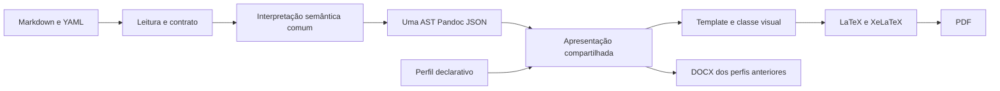

# Contrato do núcleo documental

O conteúdo é Markdown comum com um cabeçalho YAML. Parágrafos, títulos e listas
permanecem nós nativos do Pandoc. Os blocos especiais acrescentam significado,
identificadores e propriedades, sem exigir comandos de apresentação no conteúdo.

## Responsabilidades

| Camada | Arquivos | Responsabilidade |
|---|---|---|
| Conteúdo | `exemplos/`, `documentos/`, `kit/modelos/` | Texto e propriedades fornecidas; nenhum preenchimento pessoal inventado |
| Leitura e contrato | `nucleo/documento.py`, `schemas/documento.schema.json` | YAML sem campos repetidos, normalização de opcionais, metadados e bibliografias CSL |
| Interpretação | `filtros/semantica.lua`, `nucleo/lua/semantica.lua`, `catalogo.lua` | IDs, destinos, arquivos, propriedades, enumeração e chamadas; AST sem LaTeX gerado |
| Perfil | `perfis/*.json`, `nucleo/perfis.py`, `schemas/perfil.schema.json` | Tipos admitidos, formatos, template, classe, recursos visuais e padrões |
| Apresentação | `filtros/apresentacao.lua`, `nucleo/lua/apresentacao.lua`, `templates/` | Composição dos elementos interpretados para o writer selecionado, classe e identidade visual |
| Geração | `nucleo/geracao.py` | Uma interpretação por entrada; mesma AST para todos os formatos; Pandoc/citeproc/XeLaTeX |
| Interface | `scripts/renderizar.py` | Argumentos, mensagens e fachada compatível com os consumidores anteriores |

Os filtros antigos são adaptadores para os mesmos módulos; não contêm uma
segunda implementação de numeração, citações ou blocos. O citeproc resolve o
sistema autor-data e a bibliografia para todos os perfis. Os templates neutros
usam o padrão da versão instalada do Pandoc; o artigo tem seu template aprovado.

## Representação semântica

`nucleo.geracao.interpretar_documento(pandoc, documento)` retorna um dicionário
Pandoc JSON. Aceita também `Documento` com corpo e metadados em memória.
A metainformação `senai-ir-versao` identifica a versão 1 do contrato interno.

- Cada objeto mantém seu ID e recebe `senai-tipo`, `senai-numero` e `senai-nome`.
- Seu título, conteúdo, fonte e nota são Divs `senai-titulo`, `senai-conteudo`,
  `senai-fonte` e `senai-nota`. As partes ausentes são omitidas.
- Os painéis recebem `senai-painel-colunas`; seus objetos preservam os números
  da sequência comum e o contexto `senai-em-painel`.
- Os blocos pedagógicos recebem `senai-pedagogico`; seus filhos continuam
  Markdown nativo. Blocos sem conteúdo útil são removidos.
- As chamadas de objetos tornam-se links com o tipo e o número calculados.
  Citações bibliográficas continuam como nós Cite até o citeproc.

As propriedades de entrada `identificador`, `titulo`, `arquivo`, `fonte`,
`nota` e `idioma` são interpretadas pelo núcleo. A compatibilidade com `#id` e
imagens Markdown é preservada. Os metadados internos `senai-*` são gerados pelo
núcleo, sem fazer parte do cabeçalho público aceito pelo schema.

## Validação e opcionais

O lote inteiro é interpretado antes de criar as saídas. Metadados inválidos,
IDs repetidos, destinos inexistentes, arquivos ausentes e citações não
cadastradas interrompem essa etapa com o caminho/campo/ID correspondente.
Links bibliográficos diretos exigem uma obra citada, pois somente as obras
citadas recebem uma entrada e um destino na bibliografia.

Strings opcionais vazias, valores nulos e listas opcionais vazias admitidas
pelo contrato são omitidos. Um tipo incorreto não vira ausência: por exemplo,
`pre_textuais: []` é um erro. Campos obrigatórios nunca são descartados pela
normalização. Nenhuma cidade, pessoa, assinatura ou aprovação é inventada.

No artigo, capa e folha de rosto podem ser controladas individualmente.
A aprovação requer dados de coordenação, banca ou data de aprovação; apenas
informar orientação não cria essa página. O sumário só é gerado quando ativo
e quando o documento possui títulos. A presença explícita de um título no
Markdown continua sendo uma decisão de conteúdo de quem o escreve.

## Regressão e extensão

`exemplos/artigo-exemplo.pdf` permanece como referência aprovada. Os novos
documentos estão em `exemplos/nucleo/`; os testes verificam também as posições,
links e regras editoriais existentes. As verificações incluem Pandoc 3.1.3,
usado no Ubuntu 24.04 do CI, além da versão local.

Consulte a [matriz](matriz-cobertura.md), o [kit](../kit/README.md) e o
[guia de próximo template](novo-template.md). Um template novo recebe a AST
compartilhada; diferenças visuais entram no perfil, nos recursos e no template.
