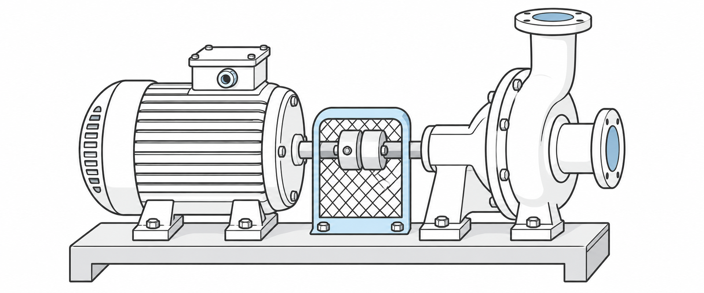

# Introdução

Uma intervenção de manutenção precisa produzir informações que permitam
compreender o estado encontrado, as ações executadas e a condição final do
equipamento. Uma leitura numérica isolada não descreve o procedimento utilizado
nem estabelece, por si só, se o componente pode retornar ao serviço.

Este artigo propõe um roteiro didático para o registro de medições em um
conjunto motor-bomba. O foco está na relação entre a evidência registrada e a
decisão técnica. O cenário é simulado e deve ser adaptado aos procedimentos,
instrumentos e critérios de aceitação adotados pela instituição ou empresa.

A @fig:conjunto-motor-bomba apresenta a disposição simplificada dos componentes.
O esquema é didático e não especifica dimensões nem instruções de montagem.

::: {.figura #fig:conjunto-motor-bomba titulo="Conjunto motor-bomba" fonte="Elaboração própria com apoio de inteligência artificial (2026)." nota="Esquema ilustrativo, sem escala."}
{width=80%}
:::

::: objetivo
Organizar um registro de medição que identifique o equipamento, o instrumento,
as condições de verificação e o critério utilizado para interpretar o resultado.
:::

# Referencial teórico

## Resultado e contexto de medição

Medir envolve comparar uma grandeza com uma referência por meio de um
procedimento. Para interpretar o resultado, é necessário conhecer a unidade,
a resolução do instrumento, a condição da superfície e os fatores que podem
influenciar a leitura. Resolução e incerteza são conceitos distintos: o menor
incremento indicado pelo instrumento não resume todas as fontes de variação.
O vocabulário de @jcgm2012 fundamenta a distinção entre as grandezas e as
características do resultado de medição.

Em uma comparação dimensional simples, a diferença entre a leitura observada
e o valor de referência pode ser representada pela @eq:desvio-dimensional.

::: {.equacao #eq:desvio-dimensional titulo="Desvio em relação ao valor de referência" fonte="Elaboração própria, com terminologia baseada em [@jcgm2012]."}
$$
\Delta x = x_{\mathrm{observado}} - x_{\mathrm{referência}}.
$$
:::

A diferença calculada precisa ser interpretada em conjunto com os limites
definidos no desenho, no manual ou no procedimento aplicável. Este exemplo não
estabelece tolerâncias universais para equipamentos de manutenção.

## Rastreabilidade do registro

O registro deve identificar a origem das informações e permitir localizar as
evidências que sustentaram a decisão. Fotografias, identificação do instrumento
e referência ao procedimento complementam a descrição textual. A equipe deve
distinguir claramente o que foi observado, o que foi calculado e o que ainda
exige investigação.
O roteiro de @macedo2026 oferece um exemplo de organização dessas evidências.

# Metodologia

O roteiro utiliza um estudo didático de situação simulada, sem coleta de dados
de uma instalação industrial. A atividade começa pela leitura da ordem de
serviço e pela identificação das grandezas relevantes para a inspeção.
Em seguida, a equipe seleciona os instrumentos e planeja o registro.

1. Identificar o conjunto, a tarefa e o procedimento aplicável.
2. Registrar o instrumento, a unidade e sua resolução.
3. Descrever as condições em que a medição será realizada.
4. Coletar e revisar as evidências conforme o procedimento autorizado.
5. Comparar o resultado com o critério documentado e justificar a decisão.

::: seguranca
A atividade prática exige procedimento autorizado, controle das fontes de
energia e supervisão. Este roteiro de registro não autoriza intervenções em
equipamentos nem substitui a análise dos riscos da tarefa.
:::

# Resultados e discussão

A @tab:desvios-medicao apresenta quatro valores simulados de desvio dimensional.
Os números servem à discussão didática e não representam resultados de uma
intervenção real. A ficha de registro deve identificar o equipamento, o
instrumento, as condições de medição, o resultado e a decisão técnica.

::: {.tabela #tab:desvios-medicao titulo="Desvios dimensionais em verificações simuladas" fonte="Elaboração própria, com dados simulados para fins didáticos (2026)." nota="A sequência não demonstra a eficácia de uma manutenção real." manter_junto="true"}
| Verificação | Desvio dimensional (mm) |
|:---|---:|
| 1ª | 0,18 |
| 2ª | 0,12 |
| 3ª | 0,07 |
| 4ª | 0,03 |
:::

O @gra:desvios-medicao exemplifica a leitura de uma sequência de verificações.
Os quatro valores são simulados para ensinar a interpretação de registros;
não descrevem o desempenho de uma intervenção real. A unidade e as condições
de medição continuam necessárias para interpretar uma diferença [@jcgm2012].

::: {.grafico #gra:desvios-medicao titulo="Desvio dimensional em verificações simuladas" fonte="Elaboração própria, com dados simulados para fins didáticos (2026)." nota="Valores simulados: 0,18; 0,12; 0,07 e 0,03 mm. A sequência não representa dados experimentais."}
{width=85%}
:::

A organização por campos reduz a possibilidade de confundir uma observação
com sua interpretação. Se o registro não identifica a unidade ou o critério de
aceitação, outra pessoa terá dificuldade para reproduzir a análise. A revisão
em equipe deve localizar essas lacunas antes da emissão do documento final.

::: pratica
Elabore uma ficha para uma situação simulada de inspeção. Troque o registro
com outra equipe e verifique se as informações permitem compreender o
procedimento, identificar as evidências e acompanhar o raciocínio técnico.
:::

# Conclusão

Um registro técnico útil relaciona o resultado ao contexto em que foi obtido.
A identificação do equipamento, do instrumento e do critério de aceitação
favorece a comunicação entre equipes e torna explícita a justificativa da
decisão. A atividade proposta permite avaliar essas relações sem apresentar
dados simulados como evidências de pesquisa de campo.

Em uma aplicação futura, o roteiro pode ser ampliado com anexos e registros
visuais, desde que o uso desses materiais esteja autorizado e que sua origem
seja identificada. Os procedimentos efetivamente utilizados devem constar
nas referências do trabalho.

# Referências {.unnumbered}

::: {#refs}
:::
