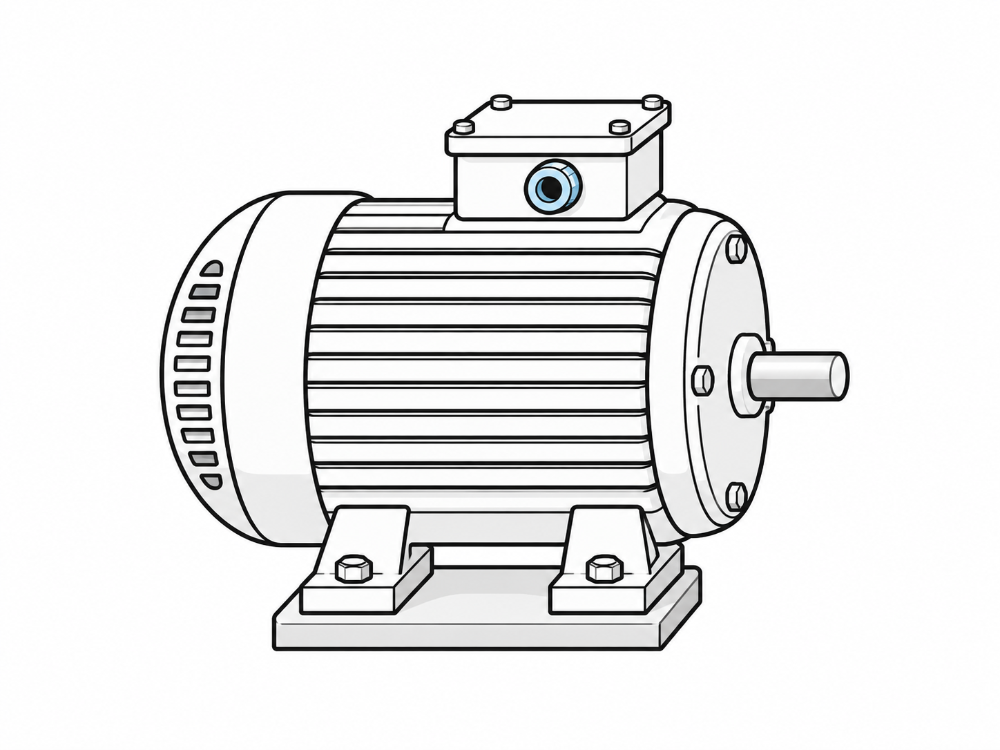

# Markdown comum {#markdown-comum}

Este documento exercita o catálogo compartilhado dos três perfis. Parágrafos,
títulos e listas permanecem em Markdown comum. Há **ênfase forte**, *ênfase*,
`código em linha`, uma [chamada interna](#markdown-comum) e uma
[referência externa ao BIPM](https://www.bipm.org/).

- Grandeza e unidade.
- Instrumento e condição de medição.

1. Preparar o registro.
2. Revisar as evidências.

> A decisão técnica deve ser sustentada por informações verificáveis.

```text
Grandeza: desvio dimensional
Unidade: mm
Origem: dados simulados para estudo
```

Uma nota curta acompanha esta afirmação.[^registro]

[^registro]: A nota demonstra o recurso nativo de rodapé do Markdown.

A relação em linha $\Delta x = x_o - x_r$ e a expressão destacada abaixo não
recebem numeração automática de objeto, pois não estão em um bloco `.equacao`.

$$
x_o = x_r + \Delta x
$$

| Campo | Finalidade |
|:---|:---|
| Grandeza | Explicitar o que é medido |
| Unidade | Permitir interpretar o valor |

A tabela simples acima é Markdown nativo. Quando precisar de numeração,
título e fonte, use o bloco semântico de tabela demonstrado adiante.

# Blocos pedagógicos

::: {.objetivo identificador="objetivo-completo"}
Interpretar um registro técnico e distinguir dados, condições e decisão.
:::

::: situacao_problema
Um registro apresenta um valor, mas omite unidade e instrumento. A equipe deve
identificar as lacunas e solicitar a informação correspondente.
:::

::: {.questao identificador="questao-completa" pontos="2" tipo="analise"}
Quais informações permitem que outra equipe revise o resultado apresentado?
:::

::: seguranca
O registro não substitui o procedimento autorizado nem a análise de riscos.
:::

::: pratica
Prepare uma ficha com dados simulados e troque-a com outra equipe para revisão.
:::

::: rubrica
Identificar a grandeza, preservar a unidade e justificar a necessidade do critério de aceitação.
:::

::: atencao
Não preencha lacunas com nomes, resultados ou referências inventados.
:::

A [questão de revisão](#questao-completa) tem um identificador estável,
independente da sua posição neste documento.

# Objetos, fontes e chamadas

Segundo @jcgm2012, a interpretação exige conceitos de medição coerentes. A
mesma obra pode ser citada entre parênteses [@jcgm2012]. A @fig:conjunto
é uma chamada antecipada; os números são calculados na ordem do conteúdo.

::: {.figura identificador="fig:conjunto" titulo="Conjunto motor-bomba" arquivo="../recursos/conjunto-motor-bomba.png" largura="75%" fonte="Ilustração didática gerada para este repositório com IA; elaboração própria (2026)." nota="Esquema sem escala." idioma="pt-BR"}
:::

O painel reúne @fig:motor e @fig:bomba. Os títulos das imagens lado a lado
ficam à esquerda; o título da imagem isolada acima fica centralizado.

:::: {.painel-imagens colunas="2"}
::: {.ilustracao identificador="fig:motor" titulo="Motor elétrico" arquivo="../recursos/motor-eletrico.png" largura="90%" fonte="Ilustração didática gerada com IA para este repositório (2026)."}
:::

::: {.desenho identificador="fig:bomba" titulo="Bomba centrífuga" arquivo="../recursos/bomba-centrifuga.png" largura="90%" fonte="Ilustração didática gerada com IA para este repositório (2026)." nota="Representação sem escala."}
:::
::::

Os aliases `.ilustracao` e `.desenho` participam da sequência de figuras.
A forma anterior de informar ID e arquivo também continua válida na
@fig:legado:

::: {.figura #fig:legado titulo="Imagem em sintaxe Markdown anterior" fonte="Ilustração didática gerada com IA para este repositório (2026)."}
{width=55%}
:::

Os dados simulados da @tab:leituras correspondem ao @gra:leituras. A nota
explica o alcance do exemplo e não é criada quando o campo está ausente.

::: {.tabela identificador="tab:leituras" titulo="Desvios dimensionais simulados" fonte="Elaboração própria, com dados simulados (2026)." nota="A sequência não representa uma manutenção real." manter_junto="true"}
| Verificação | Desvio (mm) |
|:---|---:|
| 1ª | 0,18 |
| 2ª | 0,12 |
| 3ª | 0,07 |
| 4ª | 0,03 |
:::

::: {.grafico identificador="gra:leituras" titulo="Desvio nas verificações simuladas" arquivo="../recursos/grafico-medicoes.pdf" largura="75%" fonte="Elaboração própria, com os mesmos dados simulados da tabela (2026)."}
:::

A @eq:desvio mantém um número à direita. A origem pode ser indicada em prosa
ou no campo `fonte`, sem criar uma legenda gráfica para a fórmula.

::: {.equacao identificador="eq:desvio" fonte="Relação didática entre valores de uma mesma grandeza." nota="Use unidades coerentes."}
$$
\Delta x = x_{\mathrm{observado}} - x_{\mathrm{referência}}
$$
:::

A @eq:relativo demonstra várias linhas sob um único número. A expressão
pressupõe $x_{\mathrm{referência}} \ne 0$.

::: {.equacao identificador="eq:relativo"}
$$
\varepsilon_r &= \frac{\Delta x}{x_{\mathrm{referência}}} \\
E_r &= 100\,\varepsilon_r
$$
:::

# Fechamento

A numeração, os destinos internos e as referências bibliográficas são
resolvidos pelo núcleo antes da apresentação. O arquivo pode ser usado com
outro perfil sem repetir o conteúdo nem reescrever os elementos.

# Referências {.unnumbered}

::: {#refs}
:::
